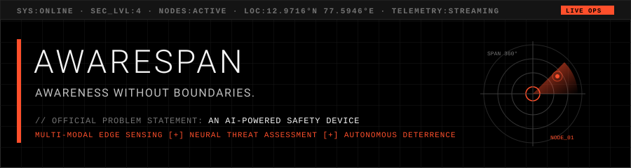

<div align="center">

  

  <br/>
  <br/>

  [](https://github.com/awarespan)
  [](https://github.com/awarespan)
  [](CONTEXT/CONTEXT.md)
  [](https://api.awarespan.bchbenjamin.in/actuator/health)
  [](https://github.com/awarespan/android-app/releases/tag/v0.4.0)
  [](CONTEXT/CONTEXT.md)
  [](https://atria.edu)

  <p align="center">
    <b>AWARESPAN is a distributed, multi-modal edge AI safety ecosystem.</b><br/>
    Combining on-device neural inference, thermal and acoustic sensing, proportional deterrence, and real-time operator telecommunications to extend situational awareness without geographical or systemic boundaries.
  </p>

  <p align="center">
    <a href="#-the-awarespan-identity">About</a> •
    <a href="#-ecosystem-repository-navigator">Ecosystem Repositories</a> •
    <a href="#-master-system-architecture">Architecture</a> •
    <a href="#-multi-modal-detection--neural-pipeline">Sensing & ML</a> •
    <a href="#-hardware-node-blueprint">Hardware</a> •
    <a href="#-design-system-zero-radius-dark-infrastructure">Design System</a> •
    <a href="#-academic--research-context">Academic Context</a> •
    <a href="#-getting-started--local-development">Getting Started</a>
  </p>

</div>

---

## 🧭 The AWARESPAN Identity

The name **AWARESPAN** combines two fundamental concepts:

- **AWARE:** Comprehensive situational awareness, multi-modal perception, real-time threat recognition, and localized machine intelligence.
- **SPAN:** Extending that awareness across diverse physical environments, connected edge nodes, operational consoles, and communities.

```text
 ┌───────────────────────────────────────────────────────────────────────────┐
 │                            A W A R E S P A N                              │
 │                                                                           │
 │   [AWARE]                                                     [SPAN]      │
 │   • Visual Detection (CSI NoIR)            • Multi-Node Mesh Infrastructure│
 │   • Acoustic Classification (MEMS)         • Real-Time WebSocket Telemetry│
 │   • Thermal Signature Sensing              • Mobile Operator Console      │
 │   • Neural Threat Assessment               • Public Web Presence          │
 └───────────────────────────────────────────────────────────────────────────┘
```

### Official Problem Statement
> **An AI-Powered Safety Device.**

### Core Positioning
AWARESPAN is not merely a CCTV camera, a weapon detector, or a standalone Raspberry Pi gadget. It is an **extensible safety technology platform** engineered to solve the fundamental failure of conventional surveillance: **passive systems record crimes but cannot prevent them in real time.**

Existing security infrastructure fails because:
- **CCTV is purely reactive**: Footage is reviewed only after harm has occurred.
- **Human fatigue limits scalability**: Operators cannot continuously monitor dozens of live streams without cognitive exhaustion.
- **Isolated roads & low-visibility zones**: Average emergency response time in isolated areas ranges from **15 to 30+ minutes**.
- **Absence of immediate deterrence**: Conventional cameras possess no active deterrent capability to disrupt an unfolding crime.

AWARESPAN bridges this gap by coupling **on-device edge AI** with **proportional autonomous deterrence** and **immediate emergency escalation**.

---

## 🗺️ Ecosystem Repository Navigator

As the primary profile and root project repository for the [`awarespan`](https://github.com/awarespan) GitHub organization, this repository coordinates the full multi-tier software and hardware ecosystem:

| Repository / Module | Role in Ecosystem | Technology Stack | Status |
| :--- | :--- | :--- | :--- |
| **[`awarespan/awarespan`](https://github.com/awarespan/awarespan)** *(This Repo)* | Master Project Hub, Public Landing Page & Technical Showcase | Vite, TanStack Start, React 19, Tailwind CSS | **Active / Production** |
| **[`awarespan/android-app`](https://github.com/awarespan/android-app)** | Mobile Operations Console for Security Personnel & Field Operators | Kotlin, Jetpack Compose, Room DB, Dagger Hilt, Android Keystore | **Release v0.4.0** |
| **`awarespan/backend`** | Central API Gateway, WebSocket Event Broker & Timescale Database | Java 17, Spring Boot 3.3.4, Neon PostgreSQL, STOMP | **Live (HTTP 200)** |
| **`awarespan/edge-node`** | Distributed Hardware Runtime, Multi-Modal Sensor Capture & Edge ML | Python 3.11, YOLOv8 (ONNX/TFLite), PyTorch, I2S Audio | **Prototyping** |

---

## 🏗️ Master System Architecture

The ecosystem operates across three decoupled, security-hardened architectural tiers:

```mermaid
flowchart TB
    subgraph SENSING["1. Multi-Modal Edge Sensing Layer"]
        CAM["RPi Camera Module 3 NoIR<br/>(12MP IMX708, 120° Wide)"]
        THERMAL["MLX90640 Thermal Array<br/>(32×24 Heat Signatures)"]
        MIC["ReSpeaker Dual MEMS Mic<br/>(I2S, 65dB SNR Far-Field)"]
        PIR["HC-SR501 PIR Sensor<br/>(Low-Power Motion Wake)"]
    end

    subgraph EDGE_CORE["2. Edge AI Autonomous Node (Raspberry Pi 5)"]
        direction TB
        GATING{"PIR Motion / Audio Spike?"}
        ML_VIS["YOLOv8n Visual Classifier<br/>(Weapons, Violent Postures, Intrusions)"]
        ML_AUD["MFCC Spectrogram CNN/LSTM<br/>(Distress Screams, Gunshots)"]
        THREAT_ENGINE["Contextual Threat Assessment Engine<br/>(Multi-Modal Confidence Matrix)"]
        
        GATING -->|Wake Trigger| ML_VIS
        GATING -->|Wake Trigger| ML_AUD
        ML_VIS --> THREAT_ENGINE
        ML_AUD --> THREAT_ENGINE
        
        subgraph LOCAL_RESPONSE["Proportional Deterrence Loop"]
            SPEAKER["5W Speaker + PAM8403 Amp<br/>(ML-Generated Deterrent Frequencies)"]
            STROBE["High-Intensity Strobe / Alarms<br/>(GPIO Actuation)"]
        end
        THREAT_ENGINE -->|Autonomous Action| SPEAKER
        THREAT_ENGINE -->|Autonomous Action| STROBE
    end

    subgraph CLOUD_GATEWAY["3. Cloud API Gateway & Telemetry Broker"]
        GATEWAY["Spring Boot 3.3.4 API Gateway<br/>https://api.awarespan.bchbenjamin.in/"]
        WSS["Real-Time STOMP / WebSocket<br/>wss://api.awarespan.bchbenjamin.in/ws/events"]
        DB[(Neon PostgreSQL<br/>TimescaleDB Telemetry)]
        GATEWAY --- DB
        WSS --- DB
    end

    subgraph OPERATOR_SURFACES["4. Operator & Public Touchpoints"]
        APP["AWARESPAN Android Console<br/>(com.awarespan.guardian · v0.4.0)"]
        WEB["AWARESPAN Web Platform<br/>(https://github.com/awarespan/awarespan)"]
    end

    SENSING ==> EDGE_CORE
    EDGE_CORE <==|TLS 1.3 / MQTT / HTTPS / 4G LTE| GATEWAY
    EDGE_CORE -.->|Live Telemetry Events| WSS
    GATEWAY <==>|HTTPS REST API| APP
    WSS <==>|Encrypted Event Stream| APP
    GATEWAY <==>|Public Showcase / Status| WEB
```

> [!IMPORTANT]
> **Strict Security Isolation**: The Android operational console and public web clients **never** connect directly to physical edge hardware nodes, local edge networks, or raw database instances. All communications are mediated, authenticated, and audited through the Spring Boot API Gateway.

---

## 👁️ Multi-Modal Detection & Neural Pipeline

AWARESPAN eliminates single-modality blind spots by cross-correlating visual, acoustic, and thermal inputs in real time:

```text
 ┌───────────────────────┬───────────────────────┬───────────────────────┐
 │   VISUAL INFERENCE    │   ACOUSTIC ANALYSIS   │   THERMAL TELEMETRY   │
 ├───────────────────────┼───────────────────────┼───────────────────────┤
 │ • Model: YOLOv8n/s    │ • Model: CNN + LSTM   │ • Sensor: MLX90640    │
 │ • Input: 1080p @ 30fps│ • Features: 128-MFCC  │ • Array: 32×24 pixels │
 │ • Target: Weapons,    │ • Sampling: 16 kHz    │ • FOV: 110° wide      │
 │   robbery postures,   │ • Target: Screams,    │ • Target: Human vs.   │
 │   crowd panic         │   gunshots, distress  │   wildlife heat sign. │
 └───────────────────────┴───────────────────────┴───────────────────────┘
                                     │
                                     ▼
       ┌───────────────────────────────────────────────────────────┐
       │     CONTEXTUAL THREAT ASSESSMENT & DETERRENCE ENGINE      │
       │     Evaluates multi-modal confidence against ambient context│
       │     Selects proportional acoustic & escalation response   │
       └───────────────────────────────────────────────────────────┘
```

### 1. Visual Detection Layer
- **Hardware**: Raspberry Pi Camera Module 3 Wide (NoIR) with dedicated IR illuminator board, providing 120° coverage and low-light operation at `<1 lux`.
- **Model**: Custom-trained YOLOv8n/s running on-device via ONNX / TFLite runtime.
- **Classifications**: Handheld weapons, aggressive physical altercations, chain-snatching approach postures, and restricted perimeter intrusions.

### 2. Acoustic Detection Layer
- **Hardware**: SEEED Studio ReSpeaker 2-Mic Pi HAT with far-field omnidirectional MEMS microphones (65 dB SNR, I2S direct digital connection).
- **Processing**: Digital noise reduction filtering followed by Mel-Frequency Cepstral Coefficients (MFCC) feature extraction.
- **Model**: Hybrid CNN-LSTM network classifying high-frequency distress calls, gunshots, breaking glass, and vehicular collision impacts at ranges exceeding 5 meters.

### 3. Thermal Heat-Signature Layer
- **Hardware**: MLX90640 far-infrared thermal sensor (32×24 resolution, 110° field of view).
- **Capability**: Penetrates dense nighttime fog, heavy rain, foliage, and zero-ambient-light shadows. Reliably differentiates human silhouettes from stray animals without relying on optical illumination.

### 4. Low-Power PIR Wake Gating
- **Hardware**: HC-SR501 PIR motion sensor.
- **Efficiency**: Keeps the high-power neural compute pipeline in low-power sleep until motion is detected within a 3–7 meter radius, optimizing off-grid solar and battery power consumption.

---

## ⚡ Threat Assessment & Proportional Deterrence

Rather than defaulting to indiscriminate false alarms, AWARESPAN implements a **Four-Tier Threat Escalation Matrix**:

| Level | Classification | Trigger Conditions | Automated Edge Deterrence | System Escalation Action |
| :---: | :--- | :--- | :--- | :--- |
| **01** | **INFO / LOW** | Isolated motion trigger or low-confidence acoustic spike (<0.50) | None. Node transitions from low-power sleep to warm standby. | Event logged in local Room cache; telemetry transmitted on next heartbeat. |
| **02** | **WARNING** | Sustained loitering in restricted perimeter or thermal anomaly (0.50–0.70) | Intermittent low-intensity directional strobe; soft acoustic warning chime. | Telemetry flag pushed to Spring Boot API Gateway; marked for operator review. |
| **03** | **HIGH THREAT** | Verified weapon presence or distress scream detected (0.71–0.85) | High-decibel focused deterrent audio frequency (85 dB SPL @ 1m); active strobes. | Instantaneous push notification to Android Console; operator verification requested. |
| **04** | **CRITICAL** | Multi-modal confirmation of active violent assault or robbery (>0.85) | Full-spectrum acoustic deterrence blast; high-intensity visual alarm sequence. | Automated emergency escalation; dispatch telemetry prepared for Law Enforcement (112). |

---

## 🔌 Hardware Node Blueprint

Each autonomous AWARESPAN edge node is designed for field resilience, India-market component availability, and solar/battery off-grid capability:

```text
 ┌───────────────────────────────────────────────────────────────────────────┐
 │                   AWARESPAN AUTONOMOUS NODE BLUEPRINT                     │
 │                                                                           │
 │   [Power Subsystem]                                                       │
 │   • Primary: 27W USB-C PD 3.0 (5.1V / 5A)                                 │
 │   • Backup: Waveshare UPS HAT (Dual 18650 Li-ion cells, 4-6h runtime)     │
 │   • Off-Grid: 18V Solar Panel + 12V Buck Converter (Optional)             │
 │                                                                           │
 │   [Compute Unit]                                                          │
 │   • Raspberry Pi 5 (Quad-Core 64-bit Arm Cortex-A76 @ 2.4GHz, 4GB LPDDR4X) │
 │                                                                           │
 │   [Sensory Peripherals]                                                   │
 │   • Camera: RPi Camera Module 3 NoIR Wide (12MP IMX708, 120° FOV, CSI)   │
 │   • Thermal: MLX90640 (32×24 Array, 110° FOV, I2C Interface)              │
 │   • Audio: ReSpeaker 2-Mic Pi HAT (Dual MEMS, 65 dB SNR, I2S Interface)   │
 │   • Wake: HC-SR501 PIR Motion Sensor (3-7m range, GPIO trigger)           │
 │                                                                           │
 │   [Telecommunications & Actuators]                                        │
 │   • Cellular: Waveshare SIM7600E-H 4G LTE Cat-4 HAT + Active GPS          │
 │   • Deterrent: 5W 8Ω Weather-Enclosed Speaker + PAM8403 Amplifier Board   │
 │   • Enclosure: IP65 Rated Weatherproof Industrial Enclosure               │
 └───────────────────────────────────────────────────────────────────────────┘
```

For complete component costs, supplier evaluation, and test bench notes, refer to [`CONTEXT/CONTEXT.md`](CONTEXT/CONTEXT.md#9-hardware-implementation-plan).

---

## 🎨 Design System: Zero-Radius Dark Infrastructure

The entire AWARESPAN ecosystem — spanning web surfaces, Android applications, and hardware status panels — adheres to the authoritative **"Server-room at midnight"** design system ([`docs/DESIGN.md`](docs/DESIGN.md)):

```text
  Void Black (#000000)      Ember Orange (#FF4F2B)      Carbon (#1A1A1A)
  ████████████████████      ████████████████████      ████████████████████
  Root Surface & Voids      Action & Power Trigger    Container & Card Fill

  Graphite Border (#3C3C3C) Bone White (#F5F5F5)       Steel Mid (#737373)
  ████████████████████      ████████████████████      ████████████████████
  1dp Hairline Dividers     Primary Architectural Text Muted Telemetry Labels
```

### Visual Principles
- **Void Black Dominance (`#000000`)**: Deep unlit black canvas minimizing eye strain during nighttime monitoring and reducing OLED energy consumption.
- **Ignited Ember Orange (`#FF4F2B`)**: An intentional, razor-sharp accent rationed strictly for actionable CTAs, live alarms, and focused inputs. Never used decoratively.
- **Zero-Radius Architecture (`0dp`)**: Absolute rejection of consumer-grade rounded cards, pill buttons, or glassmorphic blur effects. Every card, button, and input maintains sharp, right-angle geometry.
- **Hairline Graphite Dividers (`#3C3C3C`, 1dp)**: Structural hierarchy communicated through 1dp solid borders rather than drop shadows.
- **Monospaced Operational Readouts**: Terminal typography (`Chivo Mono` fallback) for ISO-8601 timestamps, sensor telemetry, and hardware node IDs.

---

## 🎓 Academic & Research Context

AWARESPAN is developed as a multi-semester research and engineering project at **Atria Institute of Technology**:

- **Institution:** Atria Institute of Technology (An Autonomous Institution Affiliated to VTU), Bengaluru – 560024
- **Programme:** B.E. in Computer Science Engineering (CSE)
- **Academic Course:** ASIP — Atria's Societal Impactful Project (Semesters 3–8)
- **Project Tracking ID:** `24UTAI13` (formerly ASIP_127)

### United Nations Sustainable Development Goals (SDGs)

| SDG Alignment | Priority | Operational Realization |
| :--- | :---: | :--- |
| **SDG 12: Law Enforcement & Governance** | **Primary** | Immediate notification to police stations; all sensor inputs cryptographically hashed as tamper-evident digital evidence. |
| **SDG 6: Disaster Management & Emergency Services** | **Secondary** | Early warning detection for structural fires, industrial explosions, and severe accidents; edge node mesh redundancy ensures operational continuity. |
| **SDG 8: Urban Structure & Transportation** | **Secondary** | Automatic detection of vehicular accidents on unlit roads; monitoring public transport stops, EV charging hubs, and fuel stations. |

### Field Research & Stakeholder Engagements
Field investigations conducted in Bengaluru informed the architectural priorities:
- **R.T. Nagar Police Station (Bengaluru)**: In-person interview with Police Inspector Mohammed Sharif confirmed that community awareness and immediate incident deterrence are vital for bridging high police-to-population ratios.
- **Urban Safety Field Data**: Studies show that chain-snatcher apprehension rates in urban zones hover at **~25%** despite CCTV prevalence, while emergency service arrival in isolated semi-urban roads averages **15–20 minutes** (exceeding **30 minutes** in unmonitored sectors).

### Project Team & Faculty Leadership

| Role | Name | Department / Affiliation | Profile |
| :--- | :--- | :--- | :--- |
| **Team Lead** | B C H Benjamin | Computer Science Engineering (1AT24CS037) | [LinkedIn](https://www.linkedin.com/in/bchbenjamin/) |
| **Team Member** | Saniya J | Computer Science Engineering (1AT24CS186) | [LinkedIn](https://www.linkedin.com/in/saniya-j-saniya-44b656355/) |
| **Team Member** | Chetan S | Electronics & Communication (1AT24EC031) | — |
| **Team Member** | Aydin Hasan K S | Electronics & Communication (1AT24EC017) | — |
| **Team Member** | Chandan B D | Electronics & Communication (1AT24EC028) | — |
| **Team Member** | Rohan C | Electronics & Computer Engineering (1AT24UE061) | — |
| **Faculty Guide** | Dr. Raghunandan G H | Associate Dean, CDC · Dept of ECE | [LinkedIn](https://www.linkedin.com/in/dr-raghunandan-g-h-64479014/) |
| **Star Faculty** | Dr. Naveen Kumar B | Professor · Dept of Information Science | [LinkedIn](https://www.linkedin.com/in/dr-naveen-kumar-b-35b83980/) |
| **Industry Mentor**| Anipriya | Technical Lead · Industry Consultant | [LinkedIn](https://www.linkedin.com/in/anipriya/) |

---

## 💻 Getting Started & Local Development

### 1. Prerequisites
- **Node.js**: Version 18.x or 20.x+
- **Package Manager**: `npm` (v9+) or `bun`
- **Git**: Installed with SSH or HTTPS authentication

### 2. Repository Setup
```bash
# Clone the master ecosystem repository
git clone https://github.com/awarespan/awarespan.git
cd awarespan

# Install dependencies with legacy peer dependency resolution
npm install --legacy-peer-deps
```

### 3. Launching the Public Web Showcase
```bash
# Start local Vite / TanStack Start development server
npm run dev
```
The application will launch at `http://localhost:3000` (or `http://localhost:5173`).

### 4. Production Build & Verification
```bash
# Execute typecheck, linting and optimized static/SSR build
npm run build

# Preview production build locally
npm run preview
```

### 5. Verifying Backend Gateway Connectivity
To confirm the status of the live AWARESPAN cloud gateway:
```bash
# Production Spring Boot Actuator probe
curl -i https://api.awarespan.bchbenjamin.in/actuator/health

# Expected Response:
# HTTP/2 200 
# {"status":"UP","service":"sip-backend"}
```

---

## 📚 Complete Project Documentation

The repository maintains in-depth technical references and research dossiers:

- [`CONTEXT/CONTEXT.md`](CONTEXT/CONTEXT.md) — The comprehensive 1,148-line Master Reference covering academic methodology, literature surveys (33 reviewed papers), ML datasets, and hardware pricing.
- [`docs/DESIGN.md`](docs/DESIGN.md) — The authoritative visual design manual detailing color tokens, typography rules, layout geometry, and interaction behaviors.
- [`docs/assets/`](docs/assets/) — Visual design assets, vector reticles, and system diagrams.

---

## ⚖️ License & Attribution

Copyright © 2026 AWARESPAN Team. All rights reserved.  
Developed under the **Atria Societal Impactful Project (ASIP)** program at **Atria Institute of Technology**, Bengaluru.

**Official Inquiries & Contact:** [awarespan@bchbenjamin.in](mailto:awarespan@bchbenjamin.in)  
**Organization:** [https://github.com/awarespan](https://github.com/awarespan)
